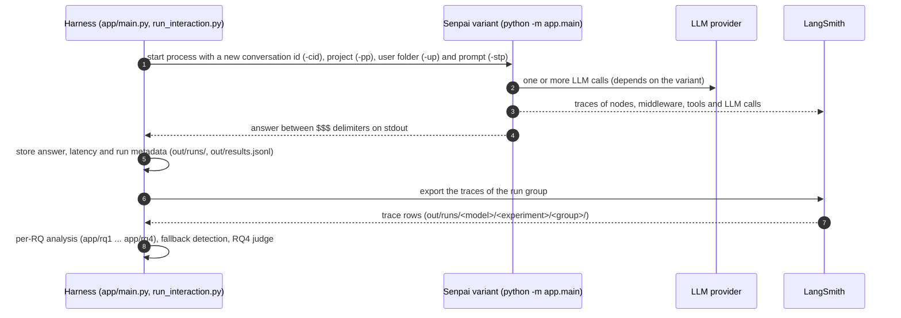

# Architecture of the evaluated Senpai variants

This folder documents the architecture of the three variants of Senpai evaluated in the experiments. Their source code is in [`assistants/`](../../assistants/).

The paper distinguishes two levels, and so does this documentation:

- **Reference architectures** (paper, Section 3): three technology-independent ways of building an LLM-based assistant for software development, namely *monolithic single-prompt*, *graph-based routed* and *agentic*.
- **Their instantiation in Senpai** (paper, Section 5): the concrete components, frameworks, prompts, validators and policies used to implement each reference architecture for the Chatbot Dojo platform. These are design decisions of our implementation, not properties of the reference architectures.

The pages below describe the instantiation, with a component view, the responsibilities of each component, and an interaction view of a representative request:

- [Monolithic single-prompt variant](monolithic.md) (`assistants/one_node/`)
- [Graph-based routed variant](graph-based.md) (`assistants/graph_based/`)
- [Agentic variant](agentic.md) (`assistants/agentic/`)

## Common context

The three variants assist in creating, fixing and explaining the three kinds of Chatbot Dojo testing artefacts: *profiles* and *rules*, stored in a Dojo project folder (`sensei_projects/<project>/`), and *connectors*, stored in the Dojo user folder (`users/user_1/connectors/`). All of them are YAML documents written in Dojo-specific DSLs.

The variants were built to differ only in their orchestration. They share the following elements:

| Element | Shared choice |
|---|---|
| Entry point | Command-line program `python -m app.main`, with the project path (`-pp`), the user path (`-up`) and, in the experiments, a single-turn prompt (`-stp`). The answer is printed between `$$$` delimiters. |
| LLM access | `init_chat_model` from LangChain, `gpt-4o-mini` by default, temperature 0.3. Other models are selected through the `SENPAI_MODEL*` environment variables. |
| Domain documentation | The same five Markdown files in `app/docs/`: profile guide (`sensei-chat-guide.md`), rule guide (`sensei-check-doc.md`), rule examples (`rules-examples.md`), connector examples (`connector-examples.md`) and custom connector guide (`custom-connector-guide.md`). |
| Code-block handling | Extraction of fenced YAML blocks (`app/assistant/codeblocks.py`) and heuristic classification of each block as a profile, rule or connector (`app/assistant/codeblock_classifier.py`). |
| Syntactic validation | The DSL parsers of the [`senpai-validators`](https://pypi.org/project/senpai-validators/) package, wrapped by `app/assistant/validation.py`. At most three validations per answer, i.e., at most two repair attempts. The monolithic variant does not validate. |
| Observability | LangChain/LangGraph tracing to LangSmith, from which the experiment harness exports the traces. |

## Mapping between reference architectures and Senpai components

The table maps the elements of the reference architectures to the components that implement them in each variant. Paths are relative to each variant's `app/` folder. A dash means the variant has no such element.

| Element | Monolithic (`one_node`) | Graph-based (`graph_based`) | Agentic (`agentic`) |
|---|---|---|---|
| Orchestration | One-node LangGraph graph (`assistant/graph.py`) | 14-node LangGraph state machine (`assistant/graph.py`) | LangChain `create_agent` loop with middleware (`assistant/agent.py`) |
| Scope control | Instructions in the system prompt only | Intent router: LLM classification, `other` ends with a fixed message (`nodes/node_intent_routing.py`, `assistant/intent.py`) | Guardrail middleware before the agent: LLM structured-output classification, LLM-written refusal (`assistant/scope_guardrail_middleware.py`) |
| Task identification | Left to the LLM inside the single prompt | Intent router, 7 intents | Left to the agent, which plans with the `write_todos` tool (`TodoListMiddleware`) |
| Documentation in context | All five files, always (`assistant/prompt.py`) | Only the files for the routed intent (`assistant/prompt.py`) | Retrieved on demand with the `get_docs` tool, selected by artefact type (`assistant/tools.py`) |
| Project and user artefacts in context | All profiles, rules and connectors, always (`assistant/project_context.py`) | Only the artefacts of the routed intent's type (`assistant/project_context.py`) | Listed, read or searched on demand with tools; similarity search over embeddings (`assistant/tools.py`, `embeddings/`) |
| Answer generation | The single node (`nodes/answer/node_prompt.py`) | One task-specific node per intent (`nodes/answer/`) | The agent's model calls |
| Validation decision | - | LLM decides whether to validate (`nodes/action/node_decide_validation_needed.py`) | LLM decides whether to validate, only if the reply contains YAML or a save call (`ValidationDecisionMiddleware`) |
| Syntactic validation | - | `nodes/action/node_detect_code_blocks.py`, `node_extract_codeblocks_metadata.py`, `node_validate_code_blocks_content.py` | `MessageValidationMiddleware` (YAML in replies) and `ToolCallValidationMiddleware` (save tool arguments) |
| Repair | - | Loop back through a repair node (`nodes/action/node_fix_invalid_code_blocks.py`) | Repair calls inside `MessageValidationMiddleware` |
| Fallback after failed repair | - | LLM-written failure message (`nodes/action/node_render_validation_failure_response.py`) | LLM-written failure message (`MessageValidationMiddleware`) |
| Actions on the project | - | - | Save and delete tools for each artefact type (`assistant/tools.py`) |
| Human-in-the-loop | - | - | Approval of save and delete tool calls (`HumanInTheLoopMiddleware`, `assistant/hitl_feedback_middleware.py`) |
| Conversation memory | Messages in the LangGraph state, optionally checkpointed in SQLite | Same as monolithic | Same, plus `SummarizationMiddleware` when the context reaches 85% of the model window |

## How the experiment harness uses the variants

The harness in this repository (`app/`) treats each variant as a black box that it runs as a separate process, so all three are exercised through the same interface. Each request is a single turn in a new conversation, so no history is carried over between requests.

The configuration of each run (variant folder, command, environment) is in [`configs/architectures.json`](../../configs/architectures.json), and the prompt benchmarks are in [`configs/`](../../configs/).
