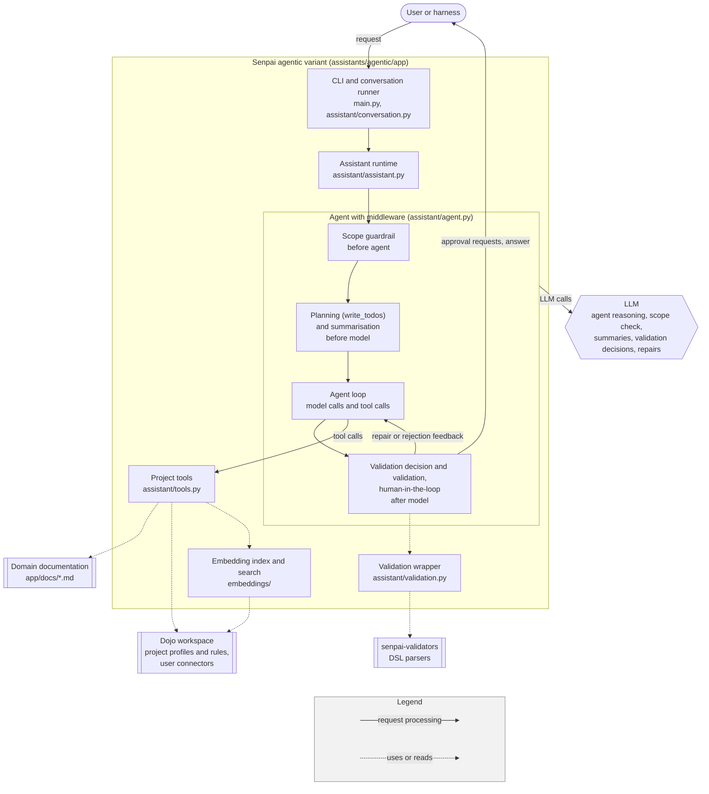
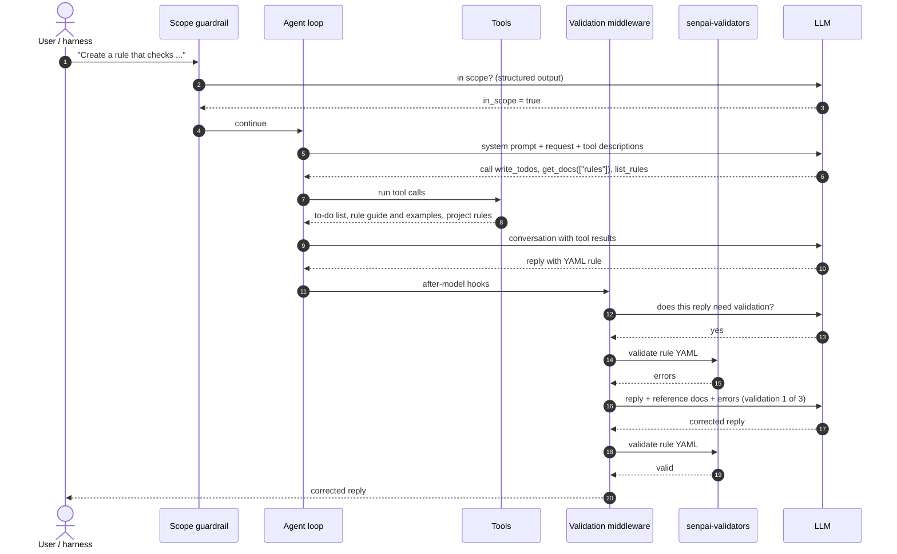

# Agentic variant

Source code: [`assistants/agentic/`](../../assistants/agentic/). Back to the [overview](README.md).

This variant implements the agentic reference architecture with LangChain's `create_agent`. The agent runs a loop in which the LLM decides which tools to call, retrieving documentation and project artefacts on demand. A stack of middleware wraps the loop with a scope guardrail, planning, summarisation, validation with repair, and human approval of write and delete actions.

## Component view

## Components

| Component | Module | Responsibility |
|---|---|---|
| CLI and conversation runner | `main.py`, `CLI/cli.py`, `assistant/conversation.py` | Arguments, single turn or conversation, resolution of pending approvals, answer between `$$$` delimiters. With `-stp` (the experiments), the save tools are not registered. |
| Assistant runtime | `assistant/assistant.py` | Initialises the chat model (temperature 0.3, `SENPAI_MODEL*` variables), the SQLite checkpointer, the embedding indexes and the agent. Sends messages and resumes interrupted runs. |
| Agent | `assistant/agent.py`, `assistant/prompt.py` | Builds the tools, the middleware stack and the agent, whose system prompt describes the assistant and how to use the tools. Unlike the other variants, the system prompt contains no documentation. |
| Project tools | `assistant/tools.py` | 16 tools: `get_docs` (documentation and examples of the requested artefact types), and for profiles, rules and connectors, `list_*`, `read_*`, `search_*` (similarity search), `save_*` and `delete_*`. |
| Embedding index and search | `embeddings/` | Builds and refreshes an embedding index of the project's profiles and rules and of the user's connectors, and answers the `search_*` tools. |
| Scope guardrail | `assistant/scope_guardrail_middleware.py` | Before the agent runs, classifies the request as in or out of scope with an LLM structured-output call. Out-of-scope requests get an LLM-written refusal and end the run. If the classifier fails, the request is allowed. |
| Planning | `TodoListMiddleware` (LangChain) | Adds the `write_todos` tool and instructions to keep an explicit to-do list for rule, profile and connector requests. The agent decides when to call it. |
| Summarisation | `SummarizationMiddleware` (LangChain) | Summarises older messages when the context reaches 85% of the model window. |
| Validation decision | `assistant/validation_middleware.py` (`ValidationDecisionMiddleware`) | If the model's reply contains YAML or a save tool call, asks the LLM whether validation is required. |
| Tool-call validation | `ToolCallValidationMiddleware` | Validates the YAML passed to `save_*` tools before they run, and returns the errors to the agent. Inactive in the experiments, since the save tools are disabled. |
| Message validation and repair | `MessageValidationMiddleware`, `assistant/validation.py` | Validates the YAML blocks of the final reply with `senpai-validators`. If they are invalid, adds the relevant documentation and the errors, and asks the LLM for a corrected reply; after the third failed validation, replaces the reply with an LLM-written failure message. |
| Human-in-the-loop | `HumanInTheLoopMiddleware` (LangChain), `assistant/hitl_feedback_middleware.py` | Interrupts the run before `save_*` and `delete_*` tool calls until the user approves, edits or rejects them, and feeds rejections back to the agent. |

LangChain runs `after_model` middleware in reverse order of declaration, so after each model call the validation middleware runs before the human-in-the-loop middleware.

## Interaction view: "create a rule" with an invalid first answer

The tools called, and their order, are chosen by the LLM and vary between runs; the sequence above is one typical path. If a run had called a `delete_*` tool, the human-in-the-loop middleware would have interrupted it and asked the user for approval before executing the call.
