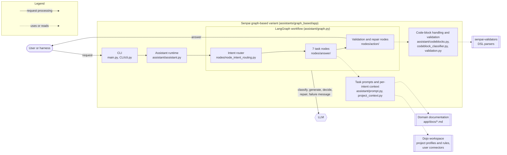
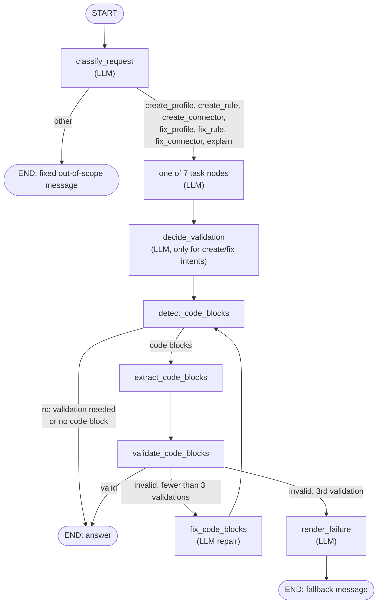
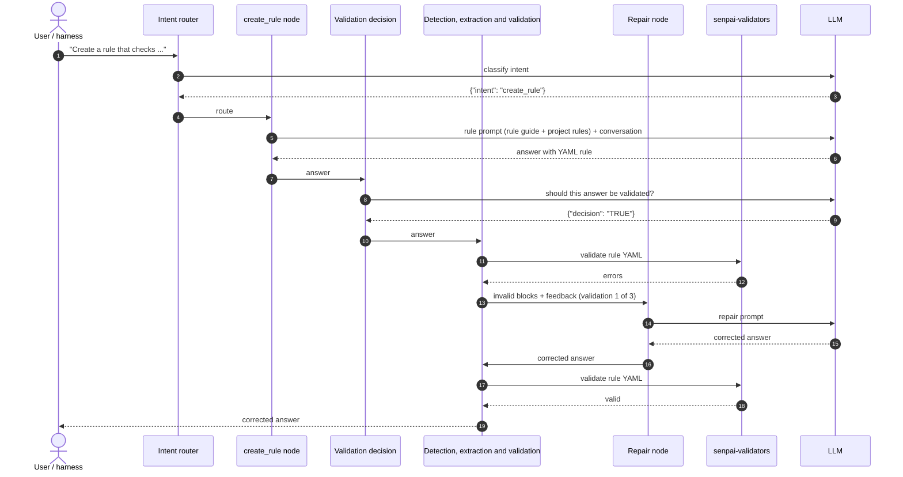

# Graph-based routed variant

Source code: [`assistants/graph_based/`](../../assistants/graph_based/). Back to the [overview](README.md).

This variant implements the graph-based routed reference architecture as a LangGraph state machine with 14 nodes. An intent router selects one of seven task-specific nodes, each with its own prompt and context. The answer then goes through a validation pipeline with a repair loop.

## Component view

## Workflow

The 14 nodes and their transitions, as defined in `assistant/graph.py`:

## Components

| Component | Module | Responsibility |
|---|---|---|
| CLI | `main.py`, `CLI/cli.py` | As in the other variants: arguments, single turn or conversation, answer between `$$$` delimiters. |
| Assistant runtime | `assistant/assistant.py` | Initialises the chat model, the optional SQLite checkpointer, the per-intent context and the graph, and streams the graph. |
| Intent router | `nodes/node_intent_routing.py`, `assistant/intent.py` | Asks the LLM to classify the latest request into `create_rule`, `create_profile`, `create_connector`, `fix_rule`, `fix_profile`, `fix_connector`, `explain` or `other` (JSON answer). `other` ends the workflow with a fixed message. |
| Task nodes | `nodes/answer/node_*.py` | One node per intent. Each prompts the LLM with its task-specific system prompt and context, plus the conversation. |
| Task prompts | `assistant/prompt.py` | Profile nodes get `sensei-chat-guide.md`; rule nodes get `sensei-check-doc.md`; connector nodes get `connector-examples.md` and `custom-connector-guide.md`; the explain node gets all five files. |
| Per-intent context | `assistant/project_context.py` | Loads the project's profiles and rules and the user's connectors. Profile, rule and connector nodes receive only the artefacts of their type; the explain node receives all of them. |
| Validation decision | `nodes/action/node_decide_validation_needed.py` | For create and fix intents, asks the LLM whether the user wants a validated answer (e.g., not when a broken artefact is requested on purpose). Defaults to validating. |
| Code-block detection and extraction | `nodes/action/node_detect_code_blocks.py`, `node_extract_codeblocks_metadata.py`, `assistant/codeblocks.py`, `assistant/codeblock_classifier.py` | Finds fenced code blocks in the answer, splits YAML documents and classifies them heuristically as profile, rule or connector. |
| Validation | `nodes/action/node_validate_code_blocks_content.py`, `assistant/validation.py` | Validates each block with the corresponding `senpai-validators` parser, counts the attempts and decides between ending, repairing and failing. |
| Repair | `nodes/action/node_fix_invalid_code_blocks.py`, `node_build_fix_system_prompt.py` | Asks the LLM to correct the invalid blocks, given the validator feedback. Its system prompt contains all five documentation files and the artefacts of the routed intent's type, and asks for the corrected code block only. The repaired answer goes through detection and validation again. |
| Failure message | `nodes/action/node_render_validation_failure_response.py` | After the third failed validation, asks the LLM to write a fallback message for the user instead of returning invalid code. |

## Interaction view: "create a rule" with an invalid first answer

In this example, the request takes four LLM calls: routing, generation, validation decision and one repair.
