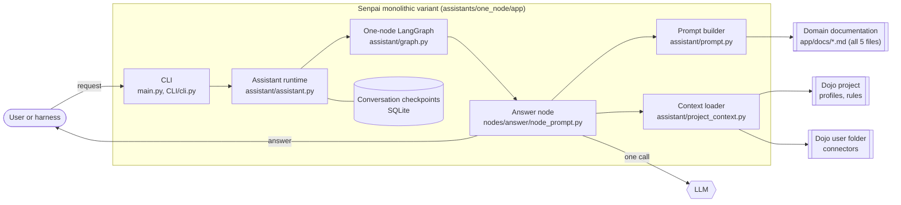
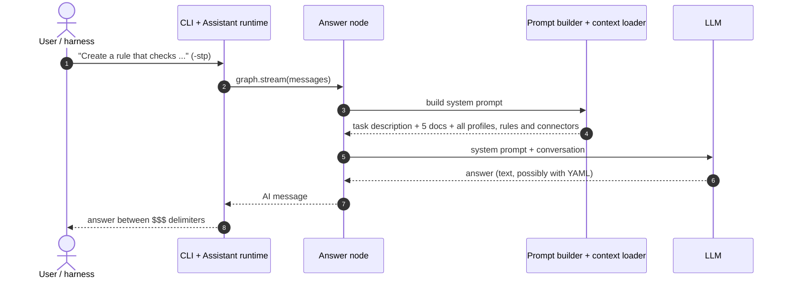

# Monolithic single-prompt variant

Source code: [`assistants/one_node/`](../../assistants/one_node/). Back to the [overview](README.md).

This variant implements the monolithic single-prompt reference architecture: every request is answered by one LLM call whose prompt contains all the information that might be relevant. It has no explicit routing, validation or repair, and serves as the baseline of the comparison.

## Component view

## Components

| Component | Module | Responsibility |
|---|---|---|
| CLI | `main.py`, `CLI/cli.py` | Parses the arguments, creates the assistant, runs one turn (`-stp`) or an interactive conversation, and prints the answer between `$$$` delimiters. |
| Assistant runtime | `assistant/assistant.py` | Initialises the chat model (`init_chat_model`, temperature 0.3, `SENPAI_MODEL*` variables), the optional SQLite checkpointer, and the graph. Streams the graph and returns the last AI message. |
| One-node graph | `assistant/graph.py` | LangGraph `START -> respond -> END`. |
| Answer node | `nodes/answer/node_prompt.py` | Builds the system prompt, prepends it to the conversation messages and invokes the LLM once. |
| Prompt builder | `assistant/prompt.py` | Task description (create, fix and explain profiles, rules and connectors, and scope instructions) followed by the full content of the five documentation files. |
| Context loader | `assistant/project_context.py` | Reads all YAML files of the Dojo project (profiles, rules) and of the user folder (connectors) and formats them as prompt sections. |

The folder `app/validator/` contains an earlier copy of the DSL parsers, which only the tests use. The answer is never validated.

## Interaction view: "create a rule"

Out-of-scope requests follow the same path: whether to refuse is decided by the LLM itself, following the scope instructions of the system prompt.
